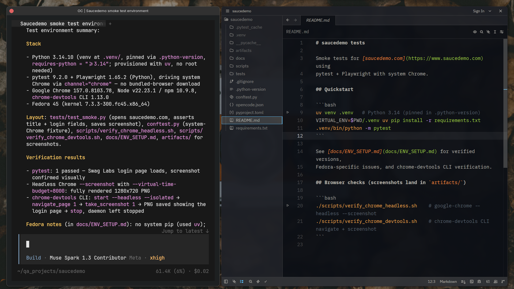

# Saucedemo Shop Test — QA Take-Home

This is a short QA project on the public demo shop https://www.saucedemo.com.
I tested login, products, cart, and checkout with all demo users.
Standard user works. The glitch users are broken on purpose, and I report them.

Full story: [report.md](report.md). Details: [route-map.md](route-map.md), [docs/test-plan.md](docs/test-plan.md), [manual-human-check.md](manual-human-check.md).

## Prerequisites

- Python 3.14+
- Google Chrome installed
- Git
- Optional: uv for fast setup, Node/npx only for DevTools check

I used: Fedora 45, Python 3.14.10 (uv), pytest 9.2.0, Playwright 1.65.2, Chrome 157, Node 22.
Full versions + Fedora fixes: [docs/ENV_SETUP.md](docs/ENV_SETUP.md).

## Quick start

With uv (fast, Linux/Mac):
```bash
uv venv .venv
VIRTUAL_ENV=$PWD/.venv uv pip install -r requirements.txt
.venv/bin/python -m pytest
```

Without uv (Linux/Mac):
```bash
python3 -m venv .venv
.venv/bin/pip install -r requirements.txt
.venv/bin/python -m pytest
```

On Windows:
```bash
py -3.14 -m venv .venv
.venv\Scripts\pip install -r requirements.txt
.venv\Scripts\python -m pytest
```
No `playwright install` needed. Tests use your system Chrome.
Headless by default, so it runs on any OS with Chrome installed.
On Mac/Windows use your normal Chrome install, same commands work.
Node/npx is only needed for the DevTools CLI check.

## How to run

Run Quick start first, then:

```bash
.venv/bin/python -m pytest                                # full suite: 34 tests
.venv/bin/python -m pytest tests/test_login.py -q        # login only
.venv/bin/python -m pytest tests/test_glitch_users.py -v -rX  # known bugs
./scripts/verify_chrome_headless.sh    # headless Chrome check
./scripts/verify_chrome_devtools.sh    # DevTools CLI check
```
Windows: use `.venv\Scripts\python -m pytest` with same args.
Expect: 29 passed, 5 xfailed in ~60s.

If a test fails, see `artifacts/fail-*.png`. Each test uses a fresh browser, so no session leaks.
Tests for known bugs are `xfail(strict=True)`. If the site is fixed, they will XPASS and fail loud.

## What I tested

In scope: login, product list and sort, product page, cart add/remove, checkout form and happy path, order finish, logout, footer links. All 6 demo users.

Out of scope: Reset App State full check, load testing, real payments, backend API.

Manual first: [manual-human-check.md](manual-human-check.md) with photos in `screenshots/manual-*.png`.
Auto: 20 cases in [docs/test-plan.md](docs/test-plan.md). 18 auto, 2 manual (slow timing, reset revert).

| Area | Cases | Status |
|---|---|---|
| Login, all users reach products | TC-01–TC-04 | pass |
| Sort, product page, footer | TC-05, TC-06, TC-15 | pass |
| Cart, checkout $32.39, guard, finish, logout | TC-07–TC-14 | pass |
| problem/error/visual bugs | TC-16–TC-18 | 5 xfail, bugs stand |
| Slow timing, reset revert | TC-19, TC-20 | manual |

## Bugs found

Full list: [docs/bugs.md](docs/bugs.md). All were seen by hand and checked with CLI.

| ID | Bug | Severity |
|---|---|---|
| BUG-1 | problem_user: all 6 images show same placeholder | Medium |
| BUG-2 | problem_user: typing Last Name wipes First Name | High |
| BUG-3 | error_user: sort does not change | Medium |
| BUG-4 | error_user: remove fails, no description on detail | Medium |
| BUG-5 | error_user: Last Name takes no input | High |
| BUG-6 | error_user: Finish shows error, no order | High |
| BUG-7 | visual_user: wrong image, wrong prices, bad buttons | Medium |

## UX review

Full list: [docs/ux-review.md](docs/ux-review.md).

1. Error text is jargon. Use plain words.
2. No order number after buy. Add order ref and summary.
3. No help in checkout fields. Add inline hints.
4. Cart badge hides at 0. Always show 0.
5. Outside links break shop flow. Open in new tab.

## AI workflow

Agent: OpenCode CLI with Meta Muse Spark 1.3 model, free tier.

AI did: map the site, draft the plan, draft the tests, save run logs.

I did: test by hand first, re-run each AI claim, keep manual as truth, fix wrong calls.

Proof: prompts in [session.md](session.md), rules in [AGENTS.md](AGENTS.md), wrong calls in [docs/ai-accuracy-log.md](docs/ai-accuracy-log.md).



## Time spent

Total: 3+ hours.

- Recon: 30+ min
- Manual: 25 min
- Plan: 20 min
- Auto: 45 min
- Bugs + UX: 15 min
- AI log: 10 min
- Report + README: 25+ min

Setup and environment: 1 hour, counted separately. Suite runs in ~60s.

## Limits and next steps

- Demo site can change without notice.
- visual_user prices change each run, so I check relative, not exact.
- Slow load is judged by hand, not in CI.
- Next: reset revert re-check, deeper a11y, other browsers, load test.

## Repo structure

```
README.md        this file
AGENTS.md        agent guide
report.md        1-page report
route-map.md     site map
manual-human-check.md  hand test + photos
session.md       prompts I used + summary
conftest.py      browser setup
tests/           pytest + Playwright
docs/            test-plan, bugs, ux-review, ai-accuracy-log, env setup
screenshots/     manual-*.png + cli-*.png
scripts/         chrome checks
agent/recon-commands.sh — read-only site map script
```
